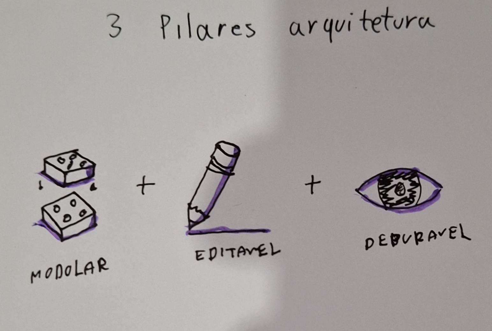

# QuackAtack: plano do MVP

Roguelite de fila, escrito em **Zig** com o **Claude Code**: uma fila que anda como cobra, unidades que atacam sozinhas e ondas de inimigos. Jogo original, com nome e arte próprios.

Este plano é **só o MVP**: o mínimo para testar a ideia e escrever o post.

**Objetivo duplo:**
1. Testar na prática as ideias da nota `Inbox/O essencial de SOAP, ECS e OOP.md` (cofre MinhaMemoria).
2. Virar um novo post da série "Explorando Arquiteturas" do blog (repositório ROG: Spaghetti, SOAP, ECS).

## O jogo (MVP)

- **Uma pata guia uma fila de patinhos.** Você só controla a direção da líder; na borda da tela ela é refletida.
- **2 classes de patinho**, que atacam sozinhas e são diferentes o bastante para testar a composição:
  - **arqueiro:** atira um projétil no inimigo mais próximo;
  - **mago:** dano em área em volta de si.
- **Ondas de inimigos** que perseguem a fila. Encostar em um inimigo tira vida da fila.
- **Fim da onda:** um patinho novo, de classe sorteada, entra no fim da fila. A fila cresce a cada onda.
- **Fim de jogo:** a vida chega a 0. A tela mostra a onda alcançada; uma tecla recomeça.
- Arte: formas simples (círculos e cores). Sem som.

## Por que Zig é um bom teste

Zig não tem classes, herança nem interfaces prontas. Isso obriga a usar só o essencial de cada arquitetura:

- **OOP:** sobram encapsulamento por módulo e funções pequenas.
- **ECS:** `std.MultiArrayList` já guarda os dados separados por campo (o layout do ECS), e as tagged unions resolvem a composição.
- **Memória:** os allocators deixam explícito quem é dono de cada dado.

**Risco com o Claude Code:** a biblioteca padrão do Zig muda bastante entre versões (I/O, `ArrayList`...), então o Claude pode escrever API antiga. Para evitar:

- fixar a versão do Zig (`minimum_zig_version` no `build.zig.zon`);
- colocar no `CLAUDE.md` a versão e o link da documentação dela;
- rodar `zig build test` depois de cada mudança.

**Stack:** Zig estável e fixado, mais **raylib-zig** (simples, 2D pronto).

## Como cada ideia de "O essencial" aparece no código

Cada ideia precisa aparecer pelo menos uma vez no MVP, senão o post não tem o que avaliar.

| Ideia | Implementação em Zig |
|---|---|
| Dados em arquivo | `data/classes.zon` (vida, dano, alcance, cooldown) e `data/waves.zon` (inimigos por onda), lidos com `std.zon` |
| Eventos como objetos | Fila `ArrayList(Event)`, com `Event` sendo uma tagged union (`damage`, `died`, `wave_ended`, `duck_joined`), processada uma vez por frame, sem callbacks |
| Variáveis observáveis | **Testar se fazem falta:** a UI (vida e onda) lê o estado direto. Isso vira um ponto do post |
| Id com generation | Pool de handles (`index` + `generation`) para inimigos e projéteis |
| Separar dados de lógica | Sistemas como funções sobre `MultiArrayList`: `mover`, `seguir`, `mirar`, `atacar`, `aplicarDano`, `limparMortos` |
| Composição | `Unit` com componentes opcionais; a classe é uma tagged union (`arqueiro`, `mago`) |
| Relacionamentos com wildcard | Registro com `(Segue, líder)` e `(Mira, inimigo)`. Quando um inimigo morre, `query(.mira, x)` acha quem o mirava para trocar de alvo; `query(.mira, .any)` lista todos que estão atacando |
| Encapsulamento | Módulo `health.zig`: a vida só muda pelas funções dele (nunca negativa, nunca acima do máximo) |

## Estrutura de pastas

```
QuackAtack/
├── build.zig  build.zig.zon
├── CLAUDE.md          ← regras do projeto para o Claude
├── PLANO.md           ← este arquivo
├── data/              ← classes.zon, waves.zon
├── src/
│   ├── main.zig       ← loop do jogo, só chama os sistemas
│   ├── world.zig      ← dados (MultiArrayList, pools)
│   ├── events.zig
│   ├── relations.zig
│   ├── health.zig
│   ├── systems/       ← um arquivo por sistema
│   └── ui/
├── tools/             ← scripts de medição
└── docs/medicoes.md   ← métricas de cada fase, para o post
```

## Fases (cada uma vira uma parte do post)

0. **Setup:** `zig init`, raylib-zig, janela abrindo, `CLAUDE.md` com as regras, primeiro teste, CI no GitHub Actions com `zig build test`.
1. **Fila:** a líder anda e vira; os patinhos seguem o histórico de posições dela; reflexão na borda.
2. **Inimigos e combate:** spawner, perseguição, pool com generation, arqueiro atirando, dano por contato, morte; tudo pela fila de eventos.
3. **Dados e classes:** `classes.zon` e `waves.zon`, sem nenhum número fixo no código; o mago; o registro de relacionamentos para mirar e trocar de alvo.
4. **Ondas e fim de jogo:** ondas vindas de dados, patinho novo no fim da onda, game over e recomeço. **Aqui o MVP está jogável.**
5. **Medições e retrospectiva:** ferramentas de medição, números finais e comparação com as versões Spaghetti, SOAP e ECS da série ROG.

As ferramentas de medição podem ser construídas aos poucos entre as fases 1 e 4, mas só são obrigatórias na fase 5.

## Metas: os 3 pilares

Os três pilares da palestra do Ryan Hipple sobre SOAP. São as metas que o código deve atingir no fim do MVP:



### Modular: dá para tirar, trocar ou testar uma parte sem mexer nas outras?

- [ ] **0 imports entre sistemas:** nenhum arquivo de `src/systems/` importa outro sistema; a comunicação é só pela fila de eventos.
- [ ] **Lógica testável sem janela:** os testes rodam em `zig build test` sem linkar a raylib.
- [ ] **Classe nova toca no máximo 2 arquivos:** o `classes.zon` e, se tiver comportamento novo, um arquivo de sistema. (O mago, na fase 3, é o teste disso.)

### Editável: dá para mudar o comportamento sem mexer no código?

- [ ] **0 números de balanceamento em `src/`:** vida, dano, alcance, tamanho de onda, tudo em `data/`.
- [ ] **Ondas vindas de dados:** mudar `waves.zon` muda o jogo sem recompilar o código.

### Depurável: dá para ver o que está acontecendo e reproduzir um bug?

- [ ] **Overlay de debug (F1):** quantidade de entidades, FPS e eventos do frame na tela.
- [ ] **Seed fixa:** a mesma seed gera a mesma partida, então todo bug pode ser reproduzido.
- [ ] **Todo bug corrigido ganha um teste** que falhava antes da correção.

### Como medir os pilares

Os pilares são qualidades, então só dá para medir por **indicadores indiretos**. Alguns **reprovam o CI** (regra sim/não), outros **só medem**, com semáforo. Os limites são uma proposta.

| Pilar | Indicador | Como medir | Regra |
|---|---|---|---|
| **Modular** | Imports entre sistemas e ciclos | `tools/analyze.zig` lê os `@import` de `src/` | **Reprova** se houver |
| Modular | Lógica testável sem engine | Passo `zig build test-headless`, sem linkar a raylib | **Reprova** se não compilar |
| **Editável** | Números mágicos em `src/` (fora de 0, 1, -1, testes e UI) | Mesmo `tools/analyze.zig`, pela `std.zig.Ast` | 🟢 0 · 🟡 1–5 · 🔴 > 5 |
| Editável | Dados válidos | Teste que carrega todo `data/*.zon` e confere referências (inimigo citado numa onda existe etc.) | **Reprova** se falhar |
| **Depurável** | Determinismo: mesma seed → mesmo estado | Teste headless roda N frames duas vezes e compara o hash do mundo | **Reprova** se diferir |
| Depurável | Todo evento aparece no debug | `switch` exaustivo sobre `Event` na formatação: o compilador reprova se faltar um tipo | **Reprova** (no build) |
| Depurável | Bug corrigido com teste | % de commits `fix:` que também alteram testes (`git log`) | 🟢 100% · 🟡 ≥ 80% · 🔴 < 80% |

**Cuidado (lei de Goodhart):** quando o indicador vira meta, dá para cumpri-lo sem cumprir o pilar (por exemplo, trocar números mágicos por constantes nomeadas em `src/` em vez de levá-los para `data/`). A avaliação final continua sendo a checklist acima, revisada à mão.

## Metas de qualidade dos testes

Além do TDD (skill `tdd`), o mesmo modelo do Partneroj (skill `quality-metrics`).

| Medição | Regra | Falha o CI? | Ferramenta em Zig |
|---|---|---|---|
| **Cobertura** (linhas) | 🟢 ≥ 90% · 🟡 80–90% · 🔴 < 80%. Só código de produção: sem testes, `ui/` e `main.zig` | Não, só relata | **kcov** sobre o binário de teste. Roda no Linux: no CI direto, no PC pelo **WSL** |
| **Mutação** | **Todo mutante sobrevivente falha o CI**, na lógica do jogo (`src/` sem `ui/` e `main.zig`). Sobrevivente ganha um teste ou `// mutation: disable — <motivo>` | **Sim** | `tools/mutate.zig`: troca `<`/`<=`, `+`/`-`, `true`/`false`, apaga `return`; roda `zig build test` em cada mutante |
| **Complexidade por função** | 🟢 até 10 · 🟡 11–15 · 🔴 acima de 15; as 5 mais complexas | Não, só mede | Mesmo `tools/analyze.zig` (conta `if`, `while`, `for`, ramos de `switch`, `and`, `or`, `catch`, `orelse`) |

- **Resumo:** `zig build quality` roda tudo e gera as tabelas com semáforo no *Job Summary* do GitHub Actions e em `docs/medicoes.md`.
- `tools/analyze.zig` junta imports, números mágicos e complexidade num só percurso da AST, para ter menos ferramentas para construir. As ferramentas também seguem TDD.
- Construir `analyze` e `mutate` em Zig com o Claude Code já é material para o post.

## O que medir (anotar em `docs/medicoes.md`)

- quantos itens dos 3 pilares estão cumpridos;
- as tabelas do `zig build quality`: cobertura, mutação, complexidade e indicadores dos pilares;
- tempo gasto e número de prompts ao Claude por fase;
- **quantas vezes o Claude escreveu API de Zig de outra versão;**
- quantidade de testes, e quantos bugs os testes pegaram;
- quantas entidades na tela antes de o FPS cair (para saber se o ECS completo faria falta).

## Regras para o `CLAUDE.md` do projeto

- Versão do Zig: **X.Y.Z** (fixar na fase 0). Consultar a documentação dessa versão antes de usar a `std`.
- Escopo: só o que está em "O jogo (MVP)": o jogo existe só para testar a ideia e escrever o post.
- Rodar `zig build test` antes de dar uma tarefa por terminada.
- Nenhum número de balanceamento no código: tudo em `data/`.
- Sistemas não chamam uns aos outros: comunicação só pela fila de eventos.
- Entidades são referenciadas por handle (index + generation), nunca por ponteiro guardado.
- Um sistema por arquivo; `main.zig` só orquestra.
- Toda lógica nova vem com teste.
- Depois que `zig build quality` existir: rodar e informar cobertura, mutação e a função mais complexa ao terminar uma tarefa (skill `quality-metrics`).
- Mutante sobrevivente: escrever o teste que o mata, ou comentar `// mutation: disable — <motivo>`. Nunca desativar sem motivo.
- Função acima de 10 de complexidade é candidata a refatorar; acima de 15, avisar.

## Estrutura do post

"Explorando Arquiteturas, parte X: o essencial em Zig com o Claude Code".

1. A tese: SOAP, ECS e OOP combatem o mesmo inimigo, o acoplamento.
2. Uma seção por fase, com as métricas.
3. Conclusão: o que funcionou, o que sobrou e se valeu a pena.
