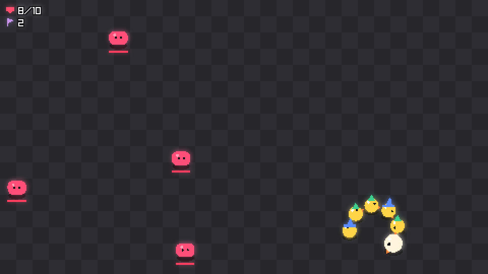

# QuackAttack



Roguelite de fila escrito em **Zig 0.17** com **raylib-zig**: uma pata guia uma
fila de patinhos que atacam sozinhos, e ondas de inimigos perseguem a fila.

**Este projeto é um experimento, não um jogo com continuação.** Ele existe para
testar na prática as ideias de SOAP, ECS e OOP em Zig, com o Claude Code, e
para servir de base a um post da série "Explorando Arquiteturas". O jogo está
completo no escopo que o experimento precisava (o MVP do `PLANO.md`) e o
projeto está encerrado.

## Jogar

Requer [devbox](https://www.jetify.com/devbox) (traz Zig, kcov, X11/OpenGL e
Mesa nas versões certas).

```bash
devbox shell
zig build run
```

No Windows, compile o executável e abra a partir da raiz do projeto (ele lê a
pasta `data/`):

```bash
devbox run windows                 # gera zig-out/bin/quackattack.exe
```
```powershell
.\zig-out\bin\quackattack.exe
```

**Controles:** ←/→ ou A/D giram a líder · F1 liga o overlay de depuração ·
R recomeça no fim de jogo.

## O jogo

- A líder anda sempre; você só escolhe para onde ela vira. Na borda, ela é
  refletida.
- Os patinhos seguem o caminho dela e atacam sozinhos: o **arqueiro** atira no
  inimigo que está mirando; o **mago** causa dano em área em volta de si.
- Os inimigos chegam em **ondas**. Encostar neles tira vida da fila. No fim de
  cada onda, entra um patinho novo, de classe sorteada.
- Com a vida em 0, a tela mostra a onda alcançada.

Todos os números do jogo ficam em `data/` (`game.zon`, `classes.zon`,
`waves.zon`) e são lidos quando o jogo abre: mudar a dificuldade não exige
recompilar.

## Como o código está organizado

- `src/game.zig` e o que ele importa: a lógica, que **nunca** importa a raylib
  e roda nos testes sem janela.
- `src/systems/`: um sistema por arquivo (`mover`, `seguir`, `spawner`,
  `perseguir`, `mirar`, `atacar`, `magia`, `projeteis`, `contato`,
  `aplicar_dano`, `limpar_mortos`, `ondas`). Sistemas não se importam: a
  comunicação é pela fila de eventos (`src/events.zig`).
- `src/pool.zig`: entidades por handle (índice + geração).
- `src/relations.zig`: relacionamentos `(Segue, líder)` e `(Mira, inimigo)`,
  com consulta por curinga.
- `src/ui/` e `src/main.zig`: desenho e orquestração, seguindo o
  `docs/guia-visual.md`.

## Qualidade

```bash
zig build test        # todos os testes (lógica, dados e ferramentas)
zig build quality     # imports, números mágicos, complexidade, cobertura e mutação
```

O `zig build quality` usa ferramentas escritas para o projeto (`tools/`) e
reprova o CI pelas regras do `PLANO.md`. Resultado no fim do experimento:
124 testes da lógica, cobertura de 100%, nenhum mutante sobrevivente, nenhum
número de balanceamento no código e mesma partida para a mesma seed.

## Documentos

- [`PLANO.md`](PLANO.md): o plano do MVP, as metas e como medi-las.
- [`docs/retrospectiva.md`](docs/retrospectiva.md): resultados, os 3 pilares,
  benchmark e comparação com as versões Spaghetti, SOAP e ECS do
  [ROG](https://github.com/solracjunio/ROG).
- [`docs/medicoes.md`](docs/medicoes.md): o diário de medições de cada fase.
- [`docs/guia-visual.md`](docs/guia-visual.md): as regras visuais.
- [`docs/img/fases/`](docs/img/fases/): uma captura por fase.
- [`CLAUDE.md`](CLAUDE.md): as regras que o Claude Code seguiu no projeto.
